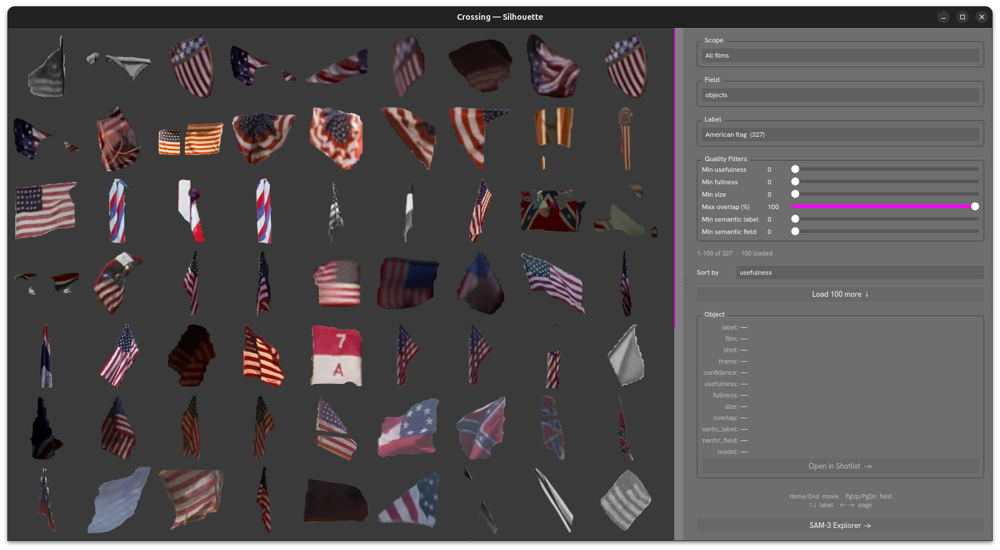

# Illustration



The `Illustration` visualizer browses extracted object silhouettes and generated engravings. It reads compact browse indexes so large catalogs open without scanning every metadata sidecar.

Open it with:

```
crossing visualizer illustration
```

## Layout

### Left — Thumbnail Grid

Displays a viewport-sized page of silhouettes or engravings. Page cells are populated incrementally so large catalogs do not block the window.

Click any thumbnail to select it and view its metadata in the Object panel.

### Right — Control Panel

#### Scope

Filter by **All films** or a specific film title.

#### Field

The annotation field the silhouettes were extracted from (e.g. `objects`, `animals`, `humans`).

#### Label

The vocabulary term to browse. The count of matching objects is shown in parentheses (e.g. `American flag (327)`).

Changing a filter clears every control below it to its generic value and removes
the current thumbnail page before fresh facets are loaded. The dependent controls
remain disabled until their replacement values are ready, so stale filter choices
and thumbnails are never displayed during a refresh.

#### Quality Filters

Sliders to refine which silhouettes are shown:

| Filter | Description |
|---|---|
| Min usefulness | Minimum usefulness score (CLIP confidence that the cutout matches the label) |
| Min fullness | Minimum coverage of the silhouette's bounding box |
| Min size | Minimum size of the object relative to the frame |
| Max overlap (%) | Maximum allowed overlap with other objects in the same shot |
| Min semantic label | Minimum semantic similarity to the label word |
| Min semantic field | Minimum semantic similarity within the annotation field |

#### Sort by

Sort the grid by `usefulness`, `size`, `fullness`, or other quality metrics.

#### Object (detail panel)

When a thumbnail is selected, shows its metadata:

- `label`, `film`, `shot`, `frame`
- `confidence`, `usefulness`, `fullness`, `size`, `overlap`
- `semantic_label`, `semantic_field`
- `model`

**Open in Shotlist →** — jump to the source shot in the Shotlist Visualizer.

## Navigation

| Key | Action |
|---|---|
| `↑` / `↓` | Previous / next label |
| `←` / `→` | Previous / next thumbnail in the grid |
| `Home` / `End` | Previous / next film |
| `PgUp` / `PgDn` | Previous / next annotation field |
| `Escape` / `Ctrl+Q` / `Ctrl+W` | Close |

### Exact Record Navigation

**Silhouette** on an engraving selects its exact active source. **Engraving** on
a silhouette selects an existing published engraving; it stays disabled while
the indexed relationship is being checked or when none exists. Multiple matches
open a small mode/provenance menu rather than choosing an arbitrary engraving.
Neither action generates assets or rebuilds indexes.

Internally, callers use `IllustrationPane.navigate_to_record(kind, identity)`,
where kind is `silhouettes` or `engravings`. `record_identity(record, kind)`
constructs the current catalog identity: media type, full filename stem, label,
object ID, optional field, and engraving mode. Display titles and labels alone
are not identities. The forward button supplies an `origin` engraving record;
the source reads its authoritative JSON reference, verifies lifecycle access,
then resolves the indexed catalog identity. Archived sources are reported, never
added to normal browsing. No future identity convention is introduced.

The destination tab activates and the old Inspector clears immediately. Known
filters are presented immediately without emitting dropdown-change signals.
The existing catalog QThread resolves the destination and its sorted page using
`services.illustration_index.resolve_record_destination`; database work stays off
the GUI thread. A read-only snapshot uses the same ordering as ordinary pages:
one record-resolution SELECT, one rank/total SELECT, one destination-page SELECT,
and four facet SELECTs (seven total, plus the index-status metadata SELECT).
No preceding pages or intermediate filter queries are loaded. The separate
published-relationship check uses the existing bounded index query.

On completion, Media/Film/Field/A-Z/Keyword are applied together with signals
blocked, and existing bounded cell population selects the exact record and
updates the Inspector. Catalog-worker identity and the browser cascade generation
discard superseded results. Another navigation, a manual filter/page/selection
change, or a tab switch interrupts the request without waiting for its I/O.
Retired workers cannot change the current filters, selection or loading state.
The existing Filter CollapsibleSection SweepBar remains active through resolution
and cell population and stops on completion, failure or interruption; no new
progress UI is used. Resize-driven page-capacity changes re-resolve the current
exact destination rather than resetting it to page one.

## SAM-3 Explorer

The **SAM-3 Explorer →** button at the bottom-right opens an interactive shot inspection panel. Browse movies → scenes → shots, enter a concept word, and click **Run SAM-3** to see segmentation masks overlaid on the best frame for that shot.

## Browse Index

Use **Rebuild Index** in either source tab after catalog changes. The action rebuilds both source indexes for the selected media type. The equivalent CLI command is:

```bash
crossing index illustration --media movie
crossing index illustration --media both  # movie and gameplay
```

Missing or stale indexes are reported in the pagination area; the visualizer does not silently scan canonical catalog directories.

Indexes use SQLite with precomputed filter values so opening filter menus remains responsive while large catalogs load. Only the visible source loads at startup; the other source loads when its tab is first selected. Indexes created by older versions are marked stale and require one rebuild.
