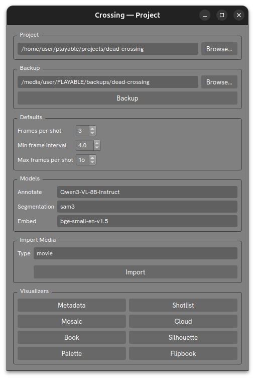

# Project



The `Project` visualizer is the main hub for Crossing Tool. It displays core project settings and provides launch buttons for every other visualizer.

Open it with:

```
crossing visualizer project
crossing visualizer          # default — opens Project
```

## Browser Statistics

The browser columns are, in order: **Movies**, **Gameplay**, **Shots**,
**Vocabulary**, **Silhouettes**, and **Engravings**.

Movie and gameplay items use the shared yellow selection highlight on hover.
Click or double-click an item to open it in the Shotlist visualizer with its
own media type selected. A title appears directly in its cell when its
word-wrapped layout fits the available height. Compact cells instead show the
title in a yellow, black-text popup matching the cell width; it appears on the
open side of the column with the canonical `3px` gap.

Shots reads `data/indexes/corpus_stats.json`; its total covers movie and
gameplay annotations, and its distribution uses the annotation `type` field.
`<untyped>` counts canonical shot annotation records whose `type` value is
missing or empty. Synthetic `<untyped>` cells use the same orange warning
color as `INDEX STALE`. Double-click a synthetic `<untyped>` cell to run the
corresponding `crossing index untyped` audit. The generated Markdown report is
saved under `outputs/audits/` and opened with the operating system's default
application. Each item is written as `shot_id (HH:MM:SS.mmm)`. Vocabulary
reads the canonical vocabulary indexes.

Silhouettes and Engravings read the current SQLite indexes under
`data/indexes/illustration/`; the Project visualizer never traverses either
source catalog. One silhouette is one indexed catalog object and contributes
to its single scalar `field`. One engraving is one indexed, generated
mode-specific record, so isolated and frame engravings from the same object are
counted separately. Each engraving has exactly one source silhouette, and its
authoritative category is the captured `silhouette.field` in engraving
provenance. Silhouettes with missing field provenance contribute to the
synthetic `<untyped>` category; engravings remain unavailable if their source
field provenance is missing.

After manually editing shot annotation JSON, rebuild this cache with:

```bash
crossing index stats --force
```

This is the simple Project-browser refresh command. The Project visualizer does
not traverse annotations or rebuild statistics itself. Close and reopen the
Project visualizer after the command if it is already open.

This command only rebuilds Project corpus statistics. If the edited annotation
text must also be reflected in semantic search, update that media type's search
index separately:

```bash
crossing index process --all --media movie
crossing index process --all --media gameplay
```

For vocabulary changes, use `crossing index vocabulary --all --force`.
The Vocabulary DATAVIS orders its fields by indexed term count, largest first.

After silhouette or engraving catalog changes, rebuild both media indexes:

```bash
crossing index illustration --media both
```

Same-schema stale Illustration indexes keep displaying their last indexed field
values while the count row says `INDEX STALE` on an orange background. Missing, malformed, or
older-schema indexes remain unavailable until rebuilt because their prior data
cannot be queried safely. A valid empty index displays a zero count and the
existing empty canvas.

## Sections

### Project

The path to your active project folder. Click **Browse…** to choose a different folder.

### Backup

**Path** selects the project-scoped backup destination; it does not open its
contents. Canceling the folder picker leaves the setting unchanged. The path stays
visible, elides in the middle when necessary, and has a full-path tooltip.

**Mirror** synchronizes the project through the same guarded service as
`crossing backup mirror`. Its states are Mirror, Preparing, Confirm, Mirroring,
and Mirror again on success (Retry on failure). Preparation runs in the background
and displays copy/update/delete counts, affected bytes, free capacity and blockers.
Click the inline **Confirm** to execute that exact reviewed plan; an ordinary
preview never applies automatically or opens a modal confirmation. Deletions still
need a separate explicit default-No authorization. Canceling before execution
leaves the backup unchanged. Adoption remains a separate advanced CLI operation.

**Verify** runs `crossing backup verify --full` asynchronously against the retained,
digest-pinned mirror plan. It does not synchronize, copy, delete or adopt payload.
Full verification can take several hours. Progress reports checked/expected files,
payload percentage when known, completed SQLite checks and the current phase.
Finishing payload checks is not success: population, source and device checks must
also pass. Unknown-duration phases do not display a made-up percentage. Only one
backup operation can run at a time; the window remains responsive.

**Cancel** requests a cooperative safe-checkpoint stop for Mirror or Verify, never
thread termination. A large file, inventory validation, or evidence hash can delay
stopping. Closing while a worker is active requests stopping and keeps ownership
of the worker/window until it finishes; close again afterward. During interrupted
mirroring, installed files and durable journals remain available for recovery.

**Last mirror** is the last successful synchronization, not the last preview or
attempt. **Last full verify** is independent: mirroring never advances it. The
service reads completed, sealed mirror evidence and persists successful full
verification metadata only after every check finishes. An older verification is
marked **previous mirror** after a newer mirror state. A new complete verification
clears that distinction. Dates survive reopening and refresh when Path changes;
missing/invalid evidence shows Unknown / Not verified. No historical success is
inferred from file dates or partial checksum logs.

Keep a verified pre-migration mirror frozen until the physical media-first
migration succeeds. See [Backup](commands.md#backup) for independent full/offline
verification and advanced reviewed-plan recovery options.

### Defaults

Persistent defaults used by the `annotate` command:

| Setting | Description |
|---|---|
| Frames per shot | Number of frames sampled per shot for annotation |
| Min frame interval | Minimum seconds between sampled frames |
| Max frames per shot | Upper cap on frames sampled for any single shot |

### Models

The AI model names used for each pipeline stage:

| Field | Default | Description |
|---|---|---|
| Annotate | `gemma4-e4b` | Vision-language model for shot annotation |
| Segmentation | `sam3.pt` | SAM model for silhouette extraction |
| Embed | `bge-small-en-v1.5` | Embedding model for semantic search |

Click a field to type a model name, or choose a locally downloaded model from the dropdown.

### Import Media

Set the default **Type** (`movie` or `gameplay`) and click **Import** to run the import pipeline for new media files.

### Tools

The four Tools actions run through the canonical CLI and show a loading indicator
on the section header while they work:

| Button | Action |
|---|---|
| Index Thumbnails | Builds missing thumbnail palettes for movie and gameplay media, then refreshes the Project browser. |
| Index Vocabulary | Rebuilds movie and gameplay vocabulary data with `crossing index vocabulary --all --force`, then refreshes the Project browser. |
| Index Illustrations | Rebuilds the Silhouette and Engraving browse indexes with `crossing index illustration --media both`, then refreshes the Project browser. |
| Index | Runs Index Thumbnails, Index Vocabulary, and Index Illustrations in sequence, then refreshes the Project browser once. |

The buttons are arranged in two rows: Thumbnails/Vocabulary, then
Illustrations/Index. Only one Tools action runs at a time. While it runs, the pressed button reads
**indexing** and the section header animates. CLI failures are written to
`outputs/logs/log-YYYY-MM-DD-HH-MM-SS.txt` and opened with the operating
system's default text viewer, without silently falling back to a GUI-side
annotation traversal.

### Visualizers

Buttons to open each of the other visualizers:

| Button | Opens |
|---|---|
| Metadata | [Metadata Visualizer](visualizer-metadata.md) |
| Shotlist | [Shotlist Visualizer](visualizer-shotlist.md) |
| Mosaic | [Mosaic Visualizer](visualizer-mosaic.md) |
| Cloud | [Cloud Visualizer](visualizer-cloud.md) |
| Book | [Book Visualizer](visualizer-book.md) |
| Illustration | [Illustration Visualizer](visualizer-illustration.md) |
| Palette | [Palette Visualizer](visualizer-palette.md) |
| Flipbook | [Flipbook Visualizer](visualizer-flipbook.md) |
